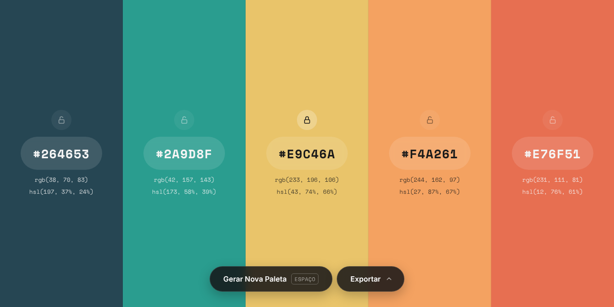
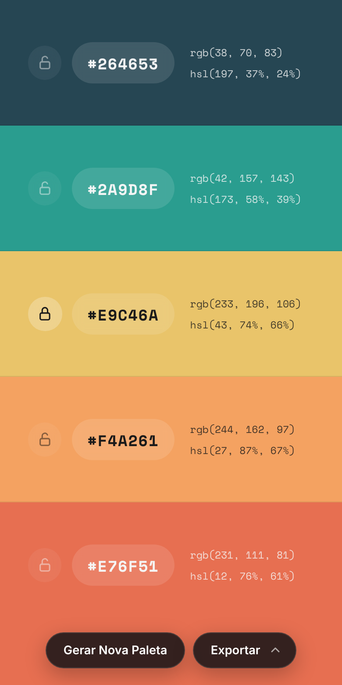

<div align="center">

# 🎨 Gerador de Paletas

Gere paletas de **5 cores aleatórias** com um clique (ou com a barra de espaço), trave as que você gostou e copie ou exporte a paleta na hora.

[](https://erickfuzer.github.io/GeradorDePaletas/)




</div>

---

## Funcionalidades

- **5 cores aleatórias** a cada geração, com transição suave entre uma paleta e outra
- **Travar cores:** clique no cadeado de uma cor e ela continua igual nas próximas gerações
- **Hex, RGB e HSL:** cada cor mostra os três formatos, e qualquer um vai para a área de transferência com um clique, com o aviso *"Copiado!"*
- **Exportar a paleta:** baixe como imagem (`paleta.png`) ou copie como variáveis CSS (`:root { --cor-1: …; }`)
- **Atalho de teclado:** aperte <kbd>Espaço</kbd> para gerar uma nova paleta
- **Texto sempre legível:** a cor do código muda entre claro e escuro conforme o brilho do fundo
- **Responsivo:** no celular as colunas viram faixas empilhadas e os botões nunca cobrem o último código

<details>
<summary>Ver no celular</summary>
<br>

</details>

## Como usar

**Online:** acesse **[erickfuzer.github.io/GeradorDePaletas](https://erickfuzer.github.io/GeradorDePaletas/)**.

**No seu computador:**

```bash
git clone https://github.com/erickfuzer/GeradorDePaletas.git
```

Depois é só abrir o `index.html` no navegador. Não precisa instalar nada.

> Copiar os códigos e exportar como CSS usam a Clipboard API, que só funciona em `https://` ou `localhost`. Se abrir o arquivo direto e a cópia falhar, use a versão online.

## Estrutura

```
GeradorDePaletas/
├── index.html    # estrutura da página e menu de exportar
├── style.css     # layout das colunas, botões e versão mobile
├── script.js     # geração das cores, travas, conversões, cópia e exportação
└── assets/       # imagens do README
```

## Como funciona

- Cada cor é um número aleatório entre `0x000000` e `0xFFFFFF`, convertido para hexadecimal. Ao gerar uma nova paleta, as colunas travadas são puladas.
- O RGB sai direto dos pares do hex (`E9` → 233), e o HSL é calculado a partir do RGB, sem bibliotecas.
- Para decidir a cor do texto e do cadeado, o script calcula o **brilho percebido** da cor com a fórmula `(R × 299 + G × 587 + B × 114) / 1000`. Acima de 150, eles ficam escuros; abaixo, claros.
- A imagem exportada é desenhada num `<canvas>`, com uma faixa e o código hex de cada cor, e baixada como `paleta.png`.

## Licença

Distribuído sob a licença [MIT](LICENSE). Use, modifique e compartilhe à vontade.

<div align="center">
<sub>Feito por <a href="https://github.com/erickfuzer">Erick Fuzer</a></sub>
</div>
